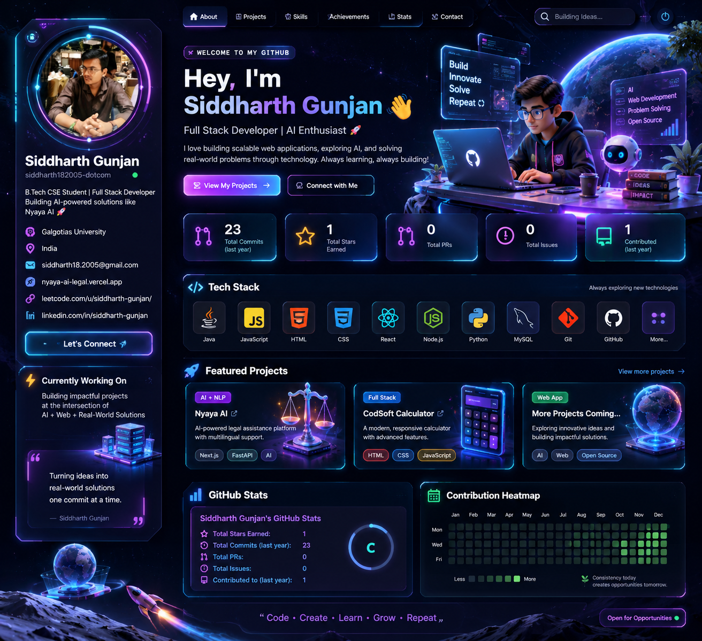

<!-- Futuristic neon hero banner -->

Code · Create · Learn · Grow · Repeat

<table>
<tr>
<td width="34%" valign="top">

◈ Developer Profile
Siddharth Gunjan

🎓 B.Tech CSE · Galgotias University
📍 India
💻 Full-Stack Developer
🤖 AI Enthusiast

Currently focused on
- Full-stack web development
- AI-powered applications
- Data structures & algorithms
- Building useful, real-world products
Connect
- Email
- LeetCode
- GitHub
</td>
<td width="66%" valign="top">

⌁ Welcome to my digital universe
I enjoy building practical applications that combine thoughtful user experiences with modern web technologies. I’m interested in how AI can make products more helpful, accessible, and intuitive.
“Turning ideas into real-world solutions, one commit at a time.”

</td>
</tr>
</table>

✦ Tech Stack

🚀 Featured Projects
<table>
<tr>
<td width="50%" valign="top">

⚖️ Nyaya AI
AI-assisted legal assistance web application

A project focused on making legal assistance and information easier to explore through a digital interface.

Highlights
- Web-based legal assistance experience
- User-focused interface
- AI-oriented problem space

</td>
<td width="50%" valign="top">

🧮 CodSoft Calculator
Interactive calculator project

A compact project demonstrating frontend fundamentals, layout, and interactive behavior.

Focus
- HTML and CSS
- JavaScript interactions
- Responsive UI fundamentals

</td>
</tr>
</table>

◉ GitHub Command Center

🟩 Contribution Orbit

Contribution visuals are loaded from third-party services and may occasionally be unavailable.

🧩 Problem Solving

🌌 Beyond the Code
- 🔭 Building projects that connect software with real-world needs
- 🧠 Learning by solving problems and shipping projects
- 🛠️ Improving code quality, design, and development workflows
- 🤝 Open to collaborating on interesting web and AI projects
⌁ Let's Connect

<!-- Replace the LinkedIn URL below with your actual LinkedIn profile URL. -->

Thanks for visiting my profile. Keep building. 🚀

